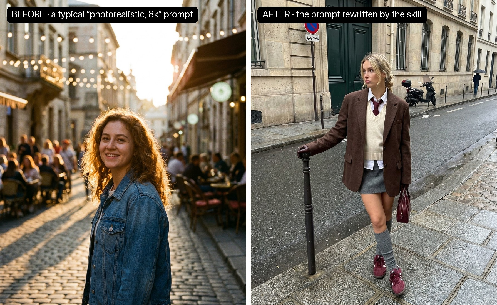
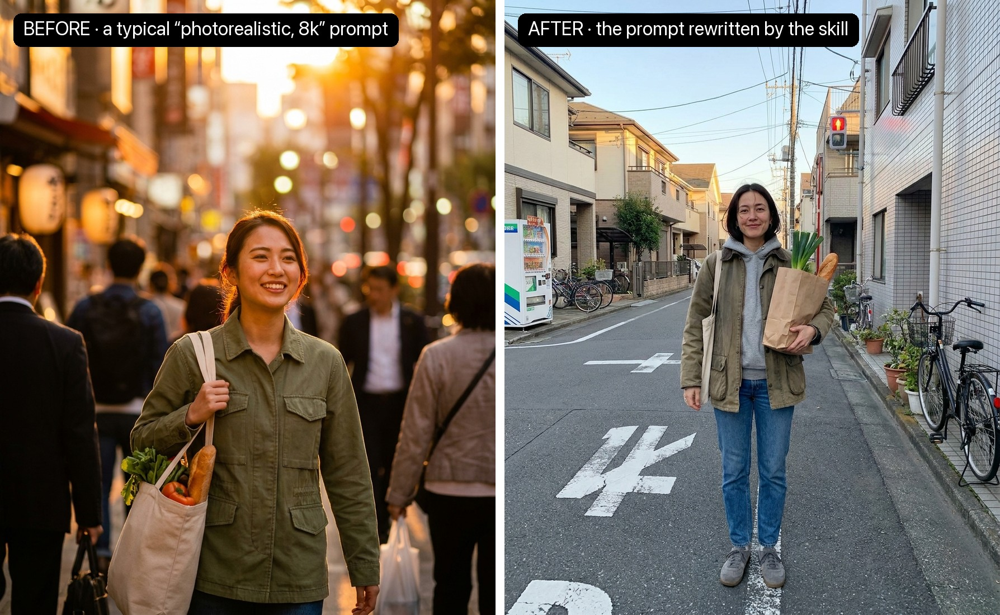

# Photo Realism



Left: the prompt most people write, "photorealistic photo of a beautiful girl on the street, 8k…". Right: what the same image model returns once this skill has rewritten the prompt. Both prompts, and a second example, are at the end of this file.

"Photorealistic, 8k, ultra detailed, cinematic lighting" is how people ask for realism, and it's exactly what makes the image look generated. Those words describe a render, so the model returns one: golden glow, creamy bokeh, a model's face, an empty perfect street. A real photo is different because of how it was **taken**: who held the phone, from where, what was happening around, what the person was doing. So this skill doesn't add quality adjectives. It rewrites the prompt into a description of a moment someone photographed.

There are two ways to fail, and the skill has to avoid both:

- **Too clean:** stock-photo light, a centred model staring at the lens, a spotless empty street, everything perfect. Reads as AI.
- **Too real:** grey sky, bins and vans, awkward framing, an unflattering moment. Reads as a bad photo nobody would post.

The target is the photo people actually save: **real, and beautiful**. A nice place with real life in it, soft or golden light, a person doing something, a good outfit, framed the way a friend frames it.

## Workflow

### 1. Parse the input

Pull out:
- **Subject:** who or what the picture is about.
- **Locks:** what must not drift. An exact product, garment, face from a reference, colour or text.
- **Use:** feed post, ad, product page, carousel. This sets the aspect ratio and what must be visible.
- **Model:** if it's known, see the notes at the end. Otherwise write model-agnostic prose.

### 2. Replace the cliché

Before writing anything, check whether the idea itself is a stock cliché: Eiffel Tower at golden hour, a laughing woman with a croissant, a café street under string lights at sunset, a man in a suit with a coffee in a glass lobby. A cliché idea stays fake however good the prompt is. Keep what the user needs (the subject, the product, the mood) and move it into a specific, ordinary, beautiful moment: a residential street on the way home, a corner shop, a ferry rail, a stoop, a market, a kitchen window.

### 3. Write the capture, not the quality

This is the single biggest lever: describe who holds the camera and from where.

| Setup | Write | Good for |
|---|---|---|
| Friend's photo (default) | "a friend stands about two metres away and holds the phone at their own eye level, tilted slightly down, so she is framed head to toe, her head reads a little larger than her feet, and the pavement fills the bottom of the frame" | Outfits, people in places |
| Mirror selfie | "a mirror selfie on an iPhone held at chest height, the phone in a plain case covering part of the face" | Outfits at home, fitting rooms, lifts |
| Caught mid-stride | "photographed from the kerb at waist height while she crosses the street mid-stride" | Movement, coats, trousers |
| Leaning shot | "from hip height on the 2x lens, leaning on a wall, ankles crossed" | Relaxed, menswear |
| Seated | "at seated eye level, sitting side-on on stone steps" | Lifestyle, food, cafés |
| Flash at night | "iPhone flash on, hard direct light, dark background" | Night out, party, bars |
| Over the table | "phone held over the table, slightly from above, hands in frame" | Food, products in use |

The friend's eye-level angle is what makes most real outfit photos look the way they do. A slightly top-down view, light foreshortening and lots of floor at the bottom of the frame read instantly as "phone, not photographer".

### 4. Put life in the place

Name the place, then 2–4 concrete things that are really there, including other people who are busy with their own lives:
- "black overhead power lines, a glowing drink vending machine against a tiled wall, a row of parked bicycles, a kid on a bike far down the street"
- "people at small round café tables, a waiter carrying cups, two parked scooters"

Real places are full. Empty streets and spotless rooms are the most common AI tell. Keep the details pleasant (plants, bikes, café chairs, shop windows), not ugly (bins, dumpsters, trash).

### 5. Give the person something to do and a face

A model's neutral stare is the second biggest tell. Pick one:
- an **action with a prop:** "half-smiling at the friend while the light is still red, a paper bag of groceries on her hip with leeks sticking out", "mid-bite", "reading a folded magazine";
- an **attitude:** "looking away down the street with a slight pout, sunglasses on";
- a **gesture:** "one hand pulling the lapel of her blazer", "pushing her hair back".

Describe the person plainly: age, hair, "natural skin with visible texture, a few strands across her face, no heavy makeup". Avoid words like beautiful, gorgeous or model, which pull the face toward the AI average.

### 6. Use one real light

Pick one and say where it comes from:
- "late afternoon, the street in soft shade while warm sun still lights the tops of the buildings";
- "flat overcast daylight, cool and even";
- "low sun from the left, long shadows";
- "window light from the side";
- "iPhone flash".

Shade with a sunlit background is the easiest beautiful light. Never write "cinematic", "dramatic" or "perfect" lighting.

### 7. Ask for the phone look

"The look of an iPhone photo: crisp and sharp everywhere with no background blur, punchy HDR, slightly over-sharpened details, true-to-life colours, slight wide-angle stretch at the edges."

Phones have deep focus, so bokeh is a tell. They also over-sharpen and push HDR. That slightly crunchy look is what reads as real, not film grain.

### 8. Make the important thing visible

If the image exists to show something (an outfit, a product, a dish), state it outright: "the whole outfit is visible from collar to shoes", "the label side of the bottle faces the camera". Without it, models crop feet, hide garments under arms and bags, and push products into shadow. A beautiful photo where you can't see the thing is useless.

### 9. End with a hard negative clause

"CRITICAL: not a fashion editorial, no studio light, no cinematic colour grade, no golden-hour glow, no bokeh, no airbrushed skin, no readable brand names."

Add "shop signs too small and far away to read" when the scene has signage, because models garble text.

### 10. Generate, check, pick

Make 2 variants of the same prompt, then check both against the tells below and keep the better one. Fix a near-miss with an edit ("Edit the image. Keep everything exactly the same and change only: …") instead of regenerating.

## Prompt template

```
A real photo a friend took on an iPhone [occasion: on the way home / at lunch / before dinner].
[Capture sentence from step 3.]
[Where and what she/he is doing, the action or attitude from step 5.]
[Plain person description: age, hair, natural skin with visible texture.]
[Outfit or product, with fit and colours; what must be visible (step 8).]
[Place with 2–4 real details and other people living their lives (step 4).]
[One light, with time and direction (step 6).]
The look of an iPhone photo: crisp and sharp everywhere with no background blur, punchy HDR,
slightly over-sharpened details, true-to-life colours, slight wide-angle stretch at the edges.
CRITICAL: not a fashion editorial, no studio light, no cinematic colour grade, no bokeh,
no airbrushed skin, no readable brand names.
```

Write it as prose, not a keyword list. Models follow sentences better than tags.

## Words to drop, words to use

| Drop (they ask for a render) | Use instead |
|---|---|
| photorealistic, hyperrealistic, 8k, ultra detailed, masterpiece | a real photo a friend took on an iPhone |
| cinematic / dramatic / perfect lighting, golden hour glow | one named light: shade, overcast, low sun from the left, window light, flash |
| bokeh, shallow depth of field, 85mm | crisp everywhere, no background blur, 1x / 2x lens |
| beautiful, gorgeous, model, flawless skin | age, hair, natural skin with visible texture |
| professional photography, editorial, studio | not a fashion editorial, candid |
| posing, looking at the camera | an action, a prop, an attitude |

## AI tells and fixes (QA checklist)

| Tell | Fix in the prompt |
|---|---|
| Empty, spotless street or room | Name 2–4 real details and other people doing their own thing |
| Model face, neutral stare into the lens | An action or attitude, a plain person description |
| Creamy background blur | "crisp everywhere, no background blur" |
| Golden glow or teal-orange grade | One named light, "true-to-life colours", negative clause |
| Camera at chest height, perfectly level | Friend's eye level tilted down, horizon a degree or two off |
| Feet cropped, product hidden | A visibility sentence (step 8) |
| Garbled text on signs or clothes | "too small and far away to read", "no readable brand names" |
| Plastic skin, perfect hair | "natural skin with visible texture, a few strands across her face" |
| Impossible clothing (an arm through a jacket's body, missing sleeves) | "both arms through the sleeves"; regenerate if it persists |
| Same scene as every other AI image (Eiffel Tower, croissant, string lights at sunset) | Step 2: change the moment, not the adjectives |

## References and edits

- **A real photo as a reference** is the strongest lever when the model accepts images. Pass it last and say: "The last image is only a reference for framing, light and photo quality; do not copy that person, their face or their clothes." Use your own photos or licensed ones, never a real person's photo for public work.
- **Product or garment references** go first, one per item. Restate each colour in words, because models drift toward the scene's colour grade.
- **Edits:** "Keep everything exactly the same and change only: …". Each edit of an edit loses realism, so go back to the original instead of chaining.

## Post-processing

Barely any. Light grain (`ffmpeg -vf noise=alls=6:allf=t`) can help an image that came out too smooth. Don't add film borders, heavy grain, vignettes or extra sharpening, because they read as a filter. Export as JPEG, like a phone does.

## Model notes

- **Nano Banana / Gemini image, GPT Image:** follow long prose well. The template works as is, and so do image references.
- **Flux, Seedream, Imagen:** same template. Keep the negative clause, since these default to glossy.
- **Midjourney:** put the capture and place first, use `--style raw`, and move the negative clause to `--no bokeh, studio, cinematic`.
- **Soul / UGC-tuned models:** already lean real. Mostly add the capture angle, the place details and the visibility sentence.

## Examples

All four images come from nano-banana-pro (4:5, 1K, text only, no reference images), two variants per prompt as in step 10, no edits or post-processing.

### 1. A bare idea (the image at the top)

**Before:**
```
Photorealistic photo of a beautiful girl on the street, 8k, ultra detailed, hyperrealistic, cinematic lighting, golden hour, bokeh, masterpiece
```

**After:**
```
A real street-style photo a friend took on an iPhone. The friend stands about two metres away and holds the phone at their own eye level, tilted slightly down, so she is framed head to toe near the middle of the shot, her head reads a little larger than her feet, and grey paving fills the bottom of the frame. She stands on a Paris street corner on a grey autumn day, weight on one leg, one gloved hand resting on a black metal bollard, the other holding a small burgundy leather bag, looking away down the street with a slight pout. A woman in her late 20s with blonde hair pulled back in a low messy twist, small gold hoop earrings, natural skin with visible texture and a few flyaway hairs. She wears an oversized chocolate-brown wool blazer worn open, a cream knit vest over a crisp white shirt with a loosely knotted burgundy tie, a grey wool mini skirt, slouchy grey knee socks bunched at the ankle and burgundy retro suede sneakers. The whole outfit is visible from collar to shoes. Behind her an ordinary street goes on: a heavy cream stone building with a tall dark green door, a red and blue no-parking sign, a curved kerb with yellow paint, damp grey asphalt, a parked scooter, a woman with an umbrella crossing far away. Flat overcast daylight, cool and even, no direct sun. The look of an iPhone photo: crisp and sharp everywhere with no background blur, punchy HDR, slightly over-sharpened details, true-to-life slightly cool colours, slight wide-angle stretch at the edges. CRITICAL: not a fashion editorial, no studio light, no cinematic colour grade, no golden hour, no bokeh, no airbrushed skin, no readable brand names.
```

The before is the AI average: a sunset street under string lights, café crowds melted into bokeh, rim-lit curls, a stock smile at the lens. The bare idea leaves everything open, so the skill picks it all (an outfit, a corner, a light, an attitude) and writes it as a moment a friend photographed on the way somewhere.

### 2. A long "realism" prompt



**Before:**
```
Ultra photorealistic portrait of a gorgeous young woman in a green jacket carrying groceries on a beautiful Tokyo street at golden hour, perfect flawless skin, cinematic lighting, dramatic sunset glow, shallow depth of field, bokeh, 85mm f/1.2, 8k, ultra detailed, hyperrealistic, masterpiece, award-winning photography, trending on artstation, octane render
```

**After:**
```
A real photo a friend took on an iPhone on the way home. The friend stands about two metres away and holds the phone at their own eye level, tilted slightly down, so she is framed head to toe near the middle of the shot, her head reads a little larger than her feet, and the grey asphalt with faded white road markings fills the bottom of the frame. She waits at a small crossing on a quiet residential street in Tokyo, weight on one leg, a paper grocery bag on her hip with green leeks and a baguette sticking out, half-smiling at the friend while the light is still red. A woman in her early 30s with a dark bob tucked behind one ear, natural skin with visible texture, a few strands across her face, no heavy makeup. She wears a faded olive barn jacket with a brown corduroy collar worn open over an oversized grey hoodie, straight mid-blue jeans with a slight break and grey suede running sneakers; a canvas tote over the other shoulder. The whole outfit is visible from collar to shoes. Around her the neighbourhood goes on: black overhead power lines criss-crossing the sky, a glowing drink vending machine against a pale tiled wall, a row of parked bicycles, a small pedestrian traffic light, low two-storey houses with potted plants by the doors, a kid on a bike far down the street. Late afternoon: the street is in soft shade while warm sun still lights the tops of the buildings. The look of an iPhone photo: crisp and sharp everywhere with no background blur, punchy HDR, slightly over-sharpened details, true-to-life colours, slight wide-angle stretch at the edges. Shop signs are too small and far away to read. CRITICAL: not a fashion editorial, no studio light, no cinematic colour grade, no bokeh, no airbrushed skin, no readable brand names.
```

The before has everything the "realism" keywords ask for: a sunset glow, creamy bokeh, glowing lanterns, a model's smile, a blurred city. The after keeps the idea (a woman, groceries, Tokyo) but describes a moment someone actually photographed.
