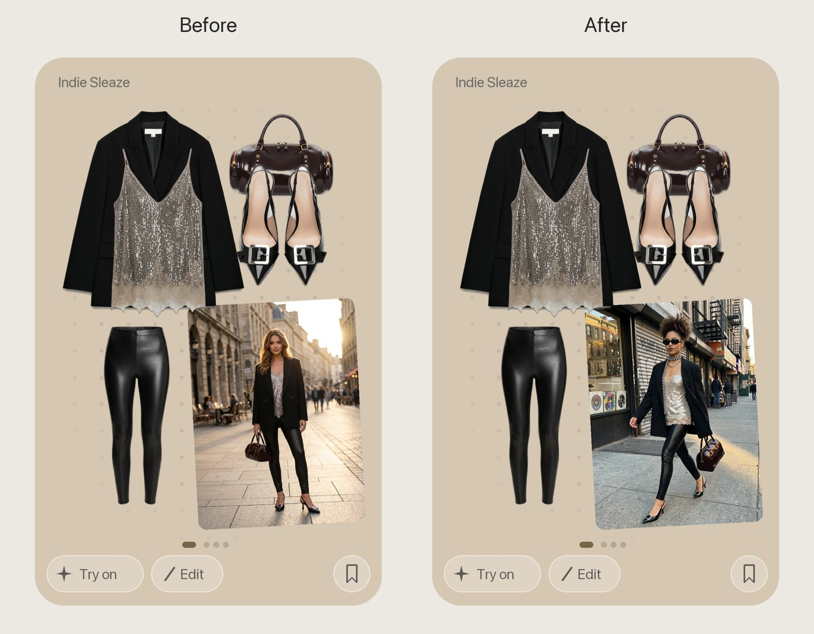
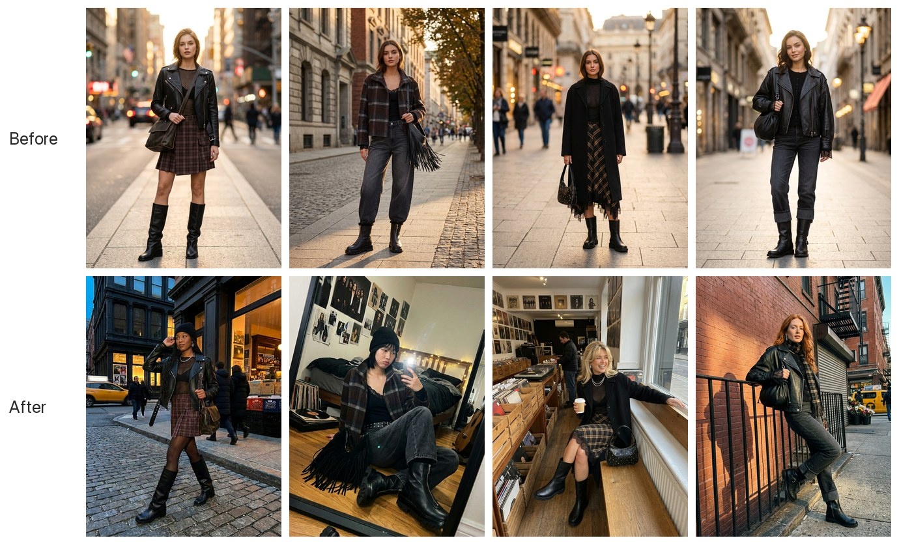

# Pinterest outfit photo



One trend card in a real fashion app. Both photos come from the same image model (Nano Banana 2) with the outfit's product images as references; the prompt is what changed. Before: the prompt most people write. After: the prompt this skill writes. The app's whole trend tab, 152 photos, was made with this skill.



Four outfits of one trend, same model and garments again. The usual prompt returns one picture four times: a centred model at eye level on the same golden-hour street with bokeh, staring at the lens. The skill's set is a street shot at blue hour, a mirror selfie on the floor, a record-shop window seat and a fence lean.

The "before" prompt, sent with the outfit's reference images:

```
Photorealistic photo of a beautiful young woman wearing the outfit from the reference images, full body shot, standing on a city street, fashion photography, 8k, ultra detailed, sharp focus, cinematic lighting, golden hour, bokeh, perfect skin, high quality, masterpiece.
```

The "after" prompts follow the template below; `references/examples.md` has four of them verbatim.

The target is a photo you would save on Pinterest and buy the look from: a confident, styled fashion influencer wears exactly the given items in an outfit post, shot from an interesting angle in a place that fits the trend's mood.

There are two ways to miss, and the pilot behind this skill hit both:
- **AI render or stock:** a glossy look, a centred person, even light, an empty street, a model stare. The art director's verdict: "looks very neural".
- **Ordinary snapshot:** real, but nobody aspires to it: "I don't want to try it on".

| Round | What we did | Verdict |
|---|---|---|
| 1 | A friend's iPhone at eye level, an overcast street or an elevator, faces hidden | Plain: "make it more Pinterest" |
| 2 | Nicer light and places, but eye level, centred, even HDR, tidy empty places, stiff poses, the same slim brunette | "Looks very neural" |
| 3 | Low angle, hard light or flash, a busy street, ordinary diverse people | Real, but "I don't want to try it on" |
| 4 | Fashion-influencer energy, confident poses, chic cities | Right energy, but a straight one-point perspective |
| 5 | Influencer + an angled composition + a mix of shot types (wavy-mirror selfie, café from above, fashion-week street style) | "That's it" |

`references/examples.md` has the round-5 prompts verbatim. Copy their structure.

This skill builds on [photo-realism](../photo-realism/SKILL.md) and differs from it in one place: for fashion posts, generic realism words ("punchy HDR, crisp everywhere") made round 2 look *more* generated. Name the kind of post instead (an influencer's phone post, a mirror selfie, street-style photography) and the model brings the right look.

## Workflow

1. **Brief.** Write down:
   - the outfit's items, each with its product image (a cutout on transparent or white works best);
   - where the photo goes (aspect ratio; 3:4 for most outfit cards);
   - the trend or mood.

   Then split it into:
   - **Locks:** every garment exactly as its product image (colour, length, shape, hardware, print, count).
   - **Free:** person, place, pose, angle, light.
   - **Extras:** accessories that are not in the outfit are allowed when they clearly complete it, such as sheer tights with a mini in winter, rings, or sunglasses on the head. Clothes and shoes never change, and an extra must never hide an outfit item.
2. **Plan the set** (anything over ~3 photos). Write a shot-list table first:

   | outfit | shot type | pose id | setting | person | light |
   |---|---|---|---|---|---|

   Use the mix and neighbour rules in `references/shots.md`, poses from `references/poses.md` and people from `references/casting.md`. Neighbouring photos differ in shot type, person, place and light, so a feed of them never repeats.

   Make sure the plan holds together before generating:
   - **Light and pose:** pair indoor poses with indoor light, and flash poses (M3, M12, S6, S10, P8) with night. When a planned pose and light conflict, keep the light and swap the pose within the same shot type.
   - **Pose and garments:** no lacing pose (S8) with pull-on boots, no knees-up pose (S2, S9) in a straight or pencil skirt, no twirl (W9) without a skirt, no back view (M5, P3) when the hero piece is on the front.
   - **Covers:** the first photo of a trend or collection is full-body. A waist-up or chin-cropped shot drops the shoes and earrings.
   - **Casting:** apply casting.md's hat-and-hair rule when assigning people.
   - **Variety across the whole feed.** Track person, set-up and prop. QA of a 152-photo batch found one person on 4 of 20 covers, two near-twin covers (same person, same gilt mirror), the same black car at fashion week 5 times, and a coffee cup in 13 of 72 men's photos. So: no person on more than 2 covers, no specific set-up (car, mirror, room) more than twice, a takeaway coffee in at most ~1 photo in 8. Vary props: a book, flowers, a phone, keys, a paper bag, sunglasses, a skateboard, nothing.
3. **References.**
   - Write `outfit.json` (`{"key": ..., "items": [{"image", "kind", "desc"}]}`, kinds: outerwear, top, dress, bottom, shoes, bag, accessory) and run `scripts/make_refs.py outfit.json --out <dir>/refs`. It writes one image per garment in the order the prompt names them, then the bag, then one board with all small accessories, plus a manifest.
   - Open every product image and read the real colour and type yourself. Product names and categories lie: "black loafers" can be burgundy, "loafers" can be lace-up derbies, a "t-shirt" can be a turtleneck, a "beanie" can be a felt hat.
   - **Check which way each image faces.** Some product photos show only the back of a jacket. Say so in the garment line ("the reference shows its back; the front has …") and describe the front in words.
   - **Sheer tops:** if the image shows no inner layer, add one as an extra in words ("a plain black bralette underneath").
   - **Product-styling extras** in a photo (a corsage pinned to a coat, shirt cuffs peeking out of a sweater) are not part of the item. Exclude them in words ("no brooch, no shirt underneath").
4. **Prompt.** Use the template below, one prompt file per shot.
5. **Generate.** `scripts/gen.py --manifest <dir>/refs/<key>.json --prompt <file> --out <dir>/out --n 2`.
   - Default to no photo reference: the 152-photo batch used none, and words were enough.
   - Add `--pose-ref <photo>` only with a real photo you have the rights to, whose framing matches the shot and whose outfit shares no garment type with yours (see shots.md: references leak).
6. **QA.**
   - Run `scripts/qa_sheet.py --manifest ... --images <dir>/out/<key>_a.png <dir>/out/<key>_b.png --out <dir>/qa_<key>.jpg`, open the sheet, and run the gate below. Pick the better passing variant.
   - **One item drifted in an otherwise good shot:** fix it with an edit instead of regenerating. Edits keep the person, pose and light.

     ```
     scripts/gen.py --edit <dir>/out/<key>_a.png --ref <dir>/refs/<key>_<k>.jpg --prompt fix.txt --out <dir>/out
     ```

     fix.txt: "Edit the first image. Keep the person, the pose, the framing, the light and every other garment exactly the same. Change only the {item} so it matches the second image exactly: {colour, shape, details}."
   - Edits are also the cheapest fix for background problems: a readable sign, plate, poster or book title, an app button, a stray photographer. Send the image alone with "remove only the lettering on …".
   - Edits sometimes zoom out a little or move the head, so check the edited image again.
   - Edits handle local changes well: text, a hat, a colour, a bag's shape, a coat's length. They fail at changing a garment's construction (suede sneakers into mesh trail shoes, adding cargo pockets); that needs a round 2 with a sharper prompt. In the batch, about half the outfits needed one edit and very few needed a round 2.
   - **Several items drifted:** make the failing garments more explicit in the prompt ("clearly knee-high", "exactly that soft rounded bag shape", "pull-on boots with no laces") and regenerate with `--tag r2`, so round 1 is kept.
   - **Round 2 and one edit still fail:** switch to a simpler shot type that shows the drifting item plainly (a mirror selfie instead of a busy street), or drop the photo reference. If that also fails, flag the outfit for a human instead of spending more.
7. **Finish.** `scripts/finish.sh <dir>/final <picked.png>...` exports JPEGs at most 1080 px wide, with no grain or vignette: the prompt already asks for the phone look.

**Waist-up and POV shots:** build a reduced outfit.json without the pieces that will be out of frame (shoes for a waist-up shot), so the model doesn't squeeze them in. A true first-person POV (P4) rarely comes out; the model makes a chin-to-shoes outfit check (P5) instead, so plan P5.

**Several agents in parallel:** give each its own folder, pass absolute paths everywhere, and run make_refs for one outfit at a time per folder. A shared scratch folder led to overwritten job files and refs written into other agents' folders.

**Cost:** about $0.07 per image (Gemini 3.1 Flash Image through OpenRouter, 3:4); each retried attempt is billed and logged to `_costs.jsonl`. In the 152-photo batch (two variants each, edit-first fixing) a finished photo cost $0.15–0.19 on average, $0.20–0.25 with planning tests. Say the count and cost before a set of more than ~12.

## Prompt template

Write prose, not keywords. Fill every slot:

```
An outfit post by a {gender} fashion influencer on Instagram, the kind of photo that makes you want to buy the whole look.
{Capture: who shoots, with what, from where; the ANGLE in words (three-quarter, from above, low, mirror at an angle, tilted a few degrees); what the frame cuts or crosses diagonally.}
{Pose from poses.md, with what the hands do and the attitude: confident, a smirk, a pout, cool, looking past the lens or straight into it.}
{Person from casting.md: beautiful, age, ethnicity, hair, makeup, one styling cue.}

{He/She} wears exactly these pieces from the reference images, fitting perfectly. They are the hero of the photo:
- the {real colour + garment + key details} (image 1), {how it is worn: open, both arms through the sleeves, sleeves pushed up};
- ... one line per reference image ...
- from image {k}: the {each small accessory with colour and how it is worn}.
{Extras, if any: "She also wears sheer black tights."}
{Visibility: what must read, e.g. "Every piece is visible from head to boots" or "everything shows in the reflection".}

{Place: specific and aspirational, matching the trend; 3–5 concrete details; other people living their lives on streets. Describe shops by what they sell, never by their sign ("a corner shop with fruit crates", not "a DELI"), and end with: "Shop signs, posters, book covers and licence plates have no readable lettering."}
{Light: one named, flattering source and direction.}
{Image-quality line for the shot type; see below.}
{If a photo reference is attached: "The last image is only a reference for pose, framing and photo quality; do not copy that person, their face or their clothes."}
The photographer and their phone or camera are not in the frame.
CRITICAL: no straight-on symmetrical composition, no studio, no plastic or airbrushed CGI skin, no readable brand names or text, not a screenshot: no app interface, buttons or overlays.
```

Image-quality lines by shot type:
- **Phone outfit post:** "The photo looks like a real influencer's iPhone outfit shot edited with a clean, slightly warm preset: true colours ({list}), sharp on her, natural skin texture."
- **Mirror selfie:** "The photo looks like a real iPhone mirror selfie: slight grain in the darker corners, true colours (...), natural skin texture."
- **Fashion-week street style:** "The photo looks like real fashion-week street-style photography: sharp on him, natural background blur from the lens, true colours (...), natural skin texture, a slight film-like warmth."

"Saved on Pinterest" in the opening line made some batch images come out as app screenshots, with save buttons and overlays drawn around the photo. So the template leaves it out and the CRITICAL line forbids app interface. The round-5 examples predate this fix: when you reuse one, drop "saved on Pinterest" and end with the template's CRITICAL line.

## Why these rules

- **The angle is the biggest lever after the person.** Models default to a centred subject at eye level with a one-point perspective. That reads as AI or catalogue, and it was rejected twice. Name the angle and say what cuts the frame diagonally: the mirror frame, a counter, a kerb, a staircase.
- **An aspirational person, not an average one.** Ordinary passers-by make the photo real but kill the desire (round 3). Use beautiful, confident, styled people with visible makeup and a personal cue, and vary hair, skin and makeup between shots.
- **Name the kind of post, not quality adjectives.** "An influencer's iPhone outfit post", "a mirror selfie", "street-style photography" carry the right optics. Realism adjectives pushed the result toward a render.
- **The outfit is the hero.** Say "fitting perfectly" and "the hero of the photo", and give each garment how it is worn. Otherwise the model restyles or simplifies.
- **One reference per garment, small accessories on one board, a photo reference last.** With more images, items blend. With the photo reference earlier, its clothes leak into the result.
- **Write "by her photographer friend" or "a street-style photographer".** "A friend took it" alone sometimes puts the friend's hand and phone into the frame.

## QA gate (reject or regenerate)

Put the shot next to the product images with `qa_sheet.py`; don't check from memory.
- **Garments.** Every outfit piece is present and matches in colour, length, shape, print, hardware and count. Known drifts:
  - knee-high boots turned into ankle boots; pull-on boots into lace-ups; pointed toes into square or round; sleek boots into UGG-style boots;
  - a bag changed shape or got an invented logo, flap or tab; a second, duplicate bag appeared;
  - chunky puffy sneakers simplified into slim retro skate shoes;
  - trousers lost their flare or changed colour;
  - a sheer top gained or lost its inner layer; an inner camisole shortened into a crop bralette;
  - a stripe, check or argyle changed scale or spread (a bold tartan became a fine beige check, an argyle band became all-over argyle);
  - toggle or button counts changed; small hardware changed colour (a brass buckle went silver);
  - crinkled glossy leather under flash turned into a python print;
  - a photo reference's garments leaked into the outfit;
  - a cropped coat came out longer; a thin tie belt became buckled straps; a scarf-jacket was worn as a shawl;
  - a straight neckline became a plunging V; a check lining was invented inside a plain trench;
  - a long sleeve became sleeveless, often after an outer-layer cue like "slipping off one shoulder" (keep such cues away from the garment underneath);
  - a flat cap turned into a panelled newsboy (fix: "driving cap, one smooth piece, no panels, no button").
- **Background text** is the single most common failure: shop signs, plates, posters, book covers. A text-removal edit fixes it every time. In the tests, 8 of 14 variants had at least one drift; expect about half to need an edit or a regeneration.
- **Invented logos, patches, tags or brand marks** on any garment fail, not only on bags.
- Carrying an item differently (a crossbody held in the hand) is fine if the item is fully visible, unless the brief says how it is worn.
- **Visibility.** Full-body shots show the shoes. Nothing important is covered by a hand, a bag, a coat flap or another garment (flares over a boot's shearling cuff, a maxi hem over the boot shafts); when a detail could be hidden this way, pick a pose that shows it (one foot forward, hem lifted, jeans tucked) and say so. In waist-up or POV shots, the visible pieces are the outfit's hero pieces.
- **Extras the model adds on its own** (earrings, rings) are fine if they are small, match the look and don't replace or compete with outfit jewelry.
- **People.** Beautiful and confident, five fingers per hand, natural limbs, no stray hand or phone of the photographer. A street-style photographer in the background is fine if he doesn't cover the outfit.
- **Composition.** Not straight-on and symmetrical. The person is large in the frame (about 70–90% of its height in full-body shots).

## Files

- `references/poses.md`: the pose library (about 60 poses by shot type, each with a prompt sentence, a visibility clause and a risk). Read it when planning or writing any prompt.
- `references/shots.md`: shot types and angles, the mix for a set, light, settings by trend vibe, and how to use a real photo as a reference.
- `references/casting.md`: the people roster and how to spread it across a set.
- `references/examples.md`: the four approved round-5 prompts, verbatim.
- `scripts/make_refs.py`, `scripts/gen.py`, `scripts/qa_sheet.py`, `scripts/finish.sh`: the pipeline above. Python 3 with Pillow; `gen.py` needs `OPENROUTER_API_KEY` (any OpenRouter image model via `IMAGE_MODEL`); `finish.sh` needs ffmpeg.
